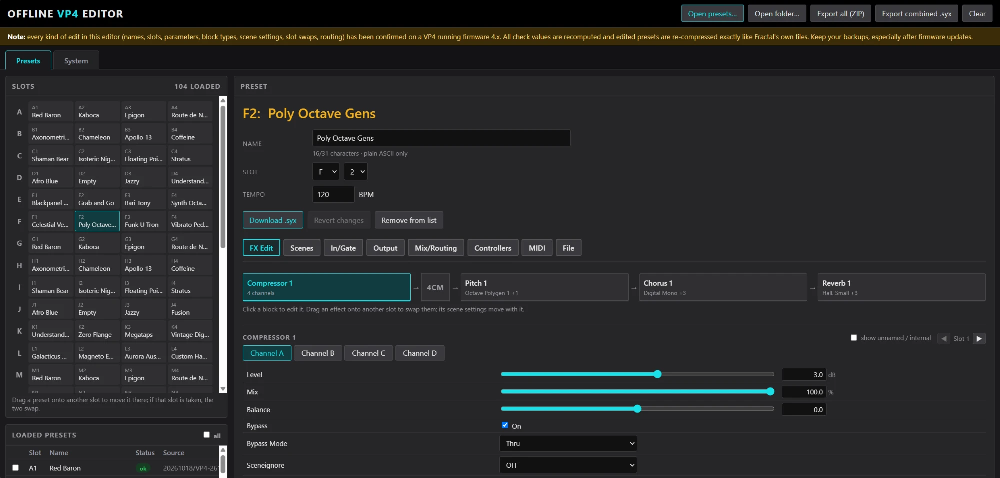

# VP4 Offline Editor

An offline, single-file HTML editor for **Fractal Audio VP4** preset and system backup files (`.syx`).
Open it in any modern browser: no installation, no server, no internet connection needed. Your files never leave your computer.

> Independent project, not affiliated with or endorsed by Fractal Audio Systems.
> Always keep a backup of your presets before sending edited files to your device.

**[▶ Open the editor in your browser](https://szecs.github.io/vp4-offline-editor/)**, or download [`vp4-offline-editor.html`](vp4-offline-editor.html) and use it offline.

## Features

**Organize presets**
- Open single presets, a whole backup folder, or a Fractal-Bot / VP4-Edit "allBanks" file (drag & drop works too)
- 26 × 4 slot grid (A1–Z4): drag a preset to another slot to move or swap it, with conflicts highlighted
- Rename presets and change their bank/slot
- Validation of every file (SysEx checksums, data CRC, end checksum, compressed body)
- Export a single `.syx`, all presets as a ZIP, or one combined `.syx`

**Edit presets** (menu like VP4-Edit)
- **FX Edit**: the effect chain in VP4 order, with parallel blocks stacked and the 4CM point shown. Click a block to edit all of its parameters per channel (A–D), with names, units and value ranges. Drag blocks to swap slots.
- **Scenes**: scene names, plus channel and on/off of every block in each scene
- **In/Gate**, **Output**, **Controllers** (with modifiers)
- **Mix/Routing**: Mix Overview (Mix/Level/Bypass Mode per FX for a scene) and Routing (Series/Parallel per FX, 4CM mode)
- **MIDI**: per-scene MIDI messages
- Preset tempo
- Changed values are highlighted and can be reset one by one, or all at once with *Revert changes*

**Edit system settings** (the `…-system.syx` file from a backup)
- Audio, Footswitches, MIDI/Remote, Global and Tuner pages, laid out like VP4-Edit's Setup pages

## Usage

1. Open https://szecs.github.io/vp4-offline-editor/, or download `vp4-offline-editor.html` and open it in Chrome, Edge or Firefox (it works without an internet connection; nothing is uploaded in either case).
2. Click **Open folder…** and choose a VP4 backup folder (or **Open presets…** for single files).
3. Edit, then use **Download .syx** (one preset or system file) or **Export all (ZIP)**.
4. Send the file to the VP4 with VP4-Edit or Fractal-Bot, as you would any preset.

Tip: try an edited preset on an empty slot first.

### Parameter definitions

The parameter names, ranges and value lists built into the page were taken from Fractal Audio's VP4-Edit 1.01.11 for **VP4 firmware 4.04**. They remain the property of Fractal Audio Systems and are included only so the editor can display presets the way VP4-Edit does.

## Tested

With VP4 firmware 4.x on a real device: renaming and moving presets, parameter and block-type changes, per-scene channel and on/off, swapping blocks between slots, routing (Series/Parallel, 4CM). Unedited files re-export byte-for-byte identical, and edited presets are re-compressed exactly the way Fractal's own files are (verified on 200+ preset files).

## Limitations

- Parameter names, ranges and value lists match **VP4 firmware 4.04**. Presets from older firmware load and edit fine, but show only the parameters they contain. Newer firmware may add parameters or types the editor doesn't know yet.
- A block type that isn't in the preset yet can't be added to a slot; existing blocks can be moved and edited.
- System settings marked **(?)** could not be identified with certainty yet. Edits to system files have not been tested on a device yet.
- User cab (IR) banks are not handled.
- FM3 presets/system files load for viewing only.

## How it works

The VP4 preset format is not publicly documented. It was worked out from backup files: see [docs/FORMAT.md](docs/FORMAT.md) for the details (SysEx framing, the Huffman-compressed preset body, check values, block and scene layout, system file).

## License

The editor's code is released under the MIT license, see [LICENSE](LICENSE). This does not cover the embedded VP4 parameter definitions, which belong to Fractal Audio Systems (see *Parameter definitions* above).
